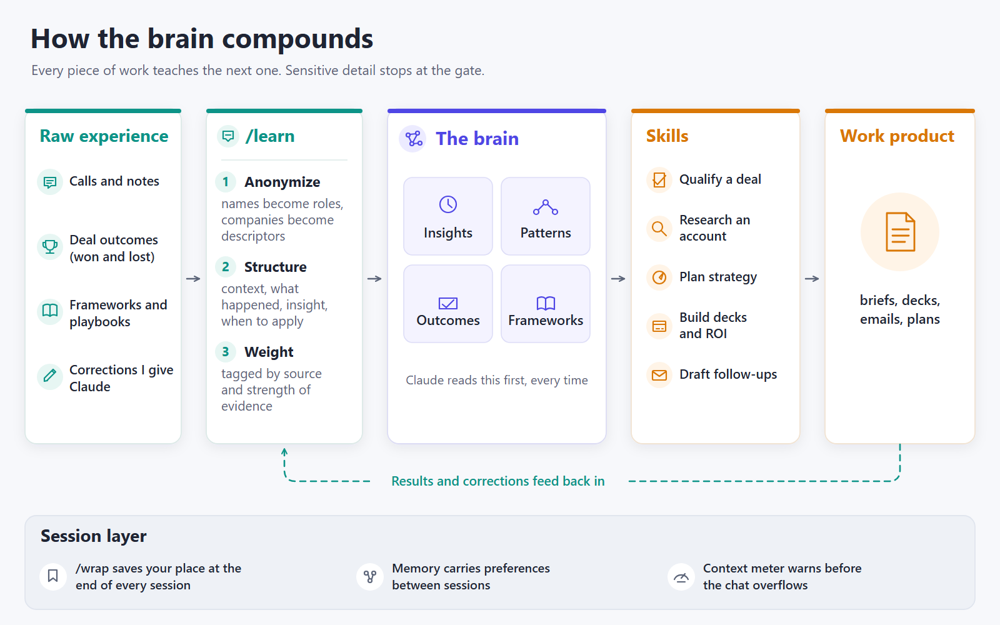

# Joe's Claude Code Utilities

Things I've built to make Claude Code more useful day to day. Each folder stands on its own, with its own README and install steps.

## What's here

| Folder | What it does | Works on |
|---|---|---|
| [**context-monitor**](context-monitor/) | A color-coded context meter in the status bar, plus alerts that Claude itself sees at 25/50/75/90% so it saves its work before compression | Mac, Windows |
| [**brain-architecture**](brain-architecture/) | How my personal knowledge system is wired: one gated way in, thin skills on a thick brain, and a feedback loop that compounds | (a diagram and the ideas) |
| [**wrap**](wrap/) | `/wrap`: closes out a session for whichever project you're in, summarizes, logs, and commits only with your OK | Mac, Windows |
| [**codex-second-opinion**](codex-second-opinion/) | Lets Claude get a second model's take, or have it draw diagrams, through your ChatGPT plan with no API bill | Windows (portable) |
| [**adversarial-reviewer**](adversarial-reviewer/) | A reviewer subagent that reads every rule in full, every run, and never filters a broken rule as a nitpick | Mac, Windows |
| [**whisper-transcribe**](whisper-transcribe/) | Local, speaker-labeled call transcripts from a two-track OBS recording, with no meeting bot | Windows + NVIDIA; Mac on CPU |

## Requirements

- [Claude Code](https://code.claude.com/docs)
- Bash for the shell scripts (built in on Mac and Linux; on Windows, Git Bash, which comes with [Git for Windows](https://git-scm.com/download/win))
- Anything else is listed in each folder's README

## Using these

Easiest: point Claude at a folder and say "install this for me", and it'll read the README and do it. Read the scripts first, as you should for anything that runs on your machine.

Issues and pull requests are welcome.

## License

MIT. See [LICENSE](LICENSE).
