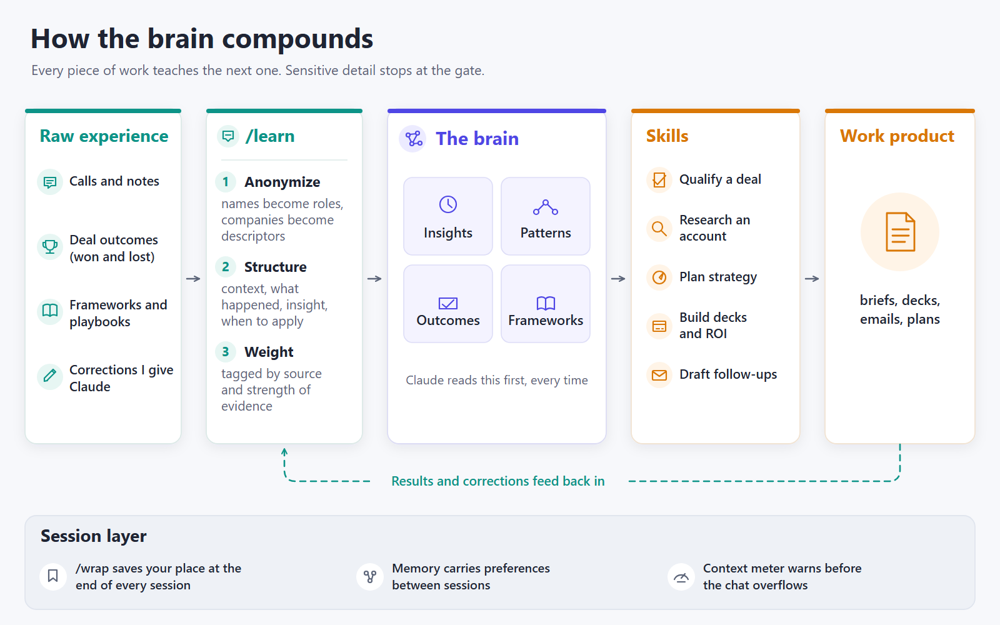

# Brain architecture

How my personal knowledge system for sales work is wired together with Claude Code. This page shows the flow, not the implementation.

## The ideas that make it work

**1. Knowledge lives in files, not in chats.** Chats end and get compressed. Files don't. Every skill reads the brain before it does anything, so each answer starts from everything learned so far instead of from zero.

**2. One way in, through a gate.** Nothing goes into the brain raw. `/learn` takes a lesson from a call, a win or a loss, or a correction, and:
- **anonymizes** it: people become roles, companies become descriptors, identifying details go
- **structures** it the same way every time: the context, what happened, the insight, and when to apply it
- **weights** it: where it came from and how much evidence is behind it, so one anecdote doesn't outvote a pattern seen across many deals

Sensitive detail stops at the gate. The brain holds lessons, not records, so it's safe to keep, sync and reuse.

**3. Skills are thin, the brain is thick.** Each skill (qualify a deal, research an account, plan strategy, build a deck or ROI model, draft a follow-up) is a short, repeatable instruction set. What makes them good is what they read first. Improving the brain improves every skill at once.

**4. The loop is what compounds.** Work product goes out, results come back (did the deal move, did the email land, did I have to correct Claude?), and those go back through `/learn`. Corrections count most: a mistake Claude made once becomes a rule it reads every time.

**5. A session layer keeps it from leaking.** `/wrap` closes every session and saves your place, memory carries preferences between sessions, and the [context monitor](../context-monitor/) warns before the chat overflows, so nothing learned mid-session gets lost to compression.

## Build your own

You don't need my files to copy the pattern. Start with:
1. One folder that Claude reads first (a `CLAUDE.md` pointing at it).
2. One `/learn` command that forces every entry through the same anonymize, structure, weight steps.
3. One skill that reads that folder before it answers.
4. [`/wrap`](../wrap/) at the end of each session.

Then keep using it. The value is in what accumulates, not in the scaffolding.
